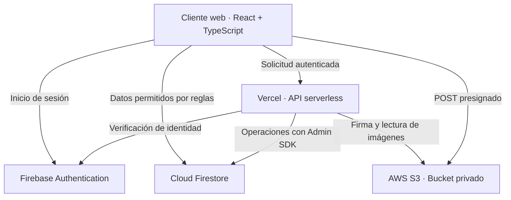

# Tech Store

Tienda online SPA educativa construida con React 18, TypeScript y Vite.
Incluye autenticación, perfiles y roles, catálogo, carrito persistente,
checkout simulado con control transaccional de stock, historial de órdenes,
administración y carga de imágenes en un bucket S3 privado.

**Autor:** Agustín Spataro · Proyecto académico Full Stack (Henry).

[Ver aplicación](https://tech-store-five-ecru.vercel.app/) ·
[Repositorio](https://github.com/spataro787/tech-store) ·
[LinkedIn](https://www.linkedin.com/in/agustin-spataro-dev/)

> El checkout simula una compra: no procesa pagos reales. La integración de
> imágenes está implementada, pero la subida a S3 tiene una incidencia de
> configuración pendiente en producción (`SignatureDoesNotMatch`).

## Funcionalidades

| Clientes | Administradores |
| --- | --- |
| Registro con email y contraseña; acceso con Google | Acceso al panel protegido por rol |
| Catálogo con búsqueda y filtro por categoría | Creación, edición y eliminación de productos |
| Detalle de producto, precio en ARS y disponibilidad | Gestión de precios, categorías y stock |
| Carrito por usuario persistido en Firestore | Carga inicial de productos sin sobrescribir existentes |
| Compra simulada con validación de precio y stock en servidor | Gestión de órdenes y transiciones de estado |
| Historial y detalle de órdenes propias | Cancelación con devolución de stock transaccional |

## Tecnologías

| Área | Herramientas |
| --- | --- |
| Interfaz | React 18, TypeScript, Vite, Tailwind CSS, React Router |
| Autenticación y datos | Firebase Authentication, Cloud Firestore |
| Backend | Funciones Node.js en Vercel, Firebase Admin SDK |
| Imágenes | AWS S3 privado, AWS SDK, POST presignado |
| Calidad | Vitest, React Testing Library, ESLint, GitHub Actions |

## Requisitos

- Node.js 24.x (también utilizado por el workflow de CI).
- npm.
- Proyecto Firebase con Authentication y Firestore.
- Proyecto Vercel para publicar la SPA y las funciones de `api/`.
- Bucket S3 privado para las imágenes de productos.

## Instalación local

```bash
git clone https://github.com/spataro787/tech-store.git
cd tech-store
npm ci
cp .env.example .env.local
npm run dev
```

En PowerShell, reemplazá `cp .env.example .env.local` por
`Copy-Item .env.example .env.local`. Completá las variables antes de iniciar
la aplicación.

Comandos de verificación:

```bash
npm test
npm run lint
npm run build
npm audit --omit=dev
```

Las funciones serverless de `api/` se ejecutan mediante Vercel (por ejemplo,
`vercel dev`); el servidor de Vite por sí solo no implementa esas rutas.

## Variables de entorno

Copiá los nombres de [.env.example](./.env.example) a `.env.local` y configurá
los valores localmente. No guardes secretos en Git, en variables `VITE_*` ni en
el código del navegador.

| Variable | Uso | Dónde configurarla |
| --- | --- | --- |
| `VITE_FIREBASE_API_KEY` | Configuración pública del cliente Firebase | `.env.local` y Vercel |
| `VITE_FIREBASE_AUTH_DOMAIN` | Dominio de Firebase Authentication | `.env.local` y Vercel |
| `VITE_FIREBASE_PROJECT_ID` | Proyecto Firebase del cliente | `.env.local` y Vercel |
| `VITE_FIREBASE_APP_ID` | Aplicación Firebase del cliente | `.env.local` y Vercel |
| `FIREBASE_ADMIN_PROJECT_ID` | Proyecto para Firebase Admin SDK | `.env.local` y Vercel, solo server |
| `FIREBASE_ADMIN_CLIENT_EMAIL` | Cuenta de servicio de Firebase Admin | `.env.local` y Vercel, solo server |
| `FIREBASE_ADMIN_PRIVATE_KEY` | Clave privada de Firebase Admin | `.env.local` y Vercel, solo server |
| `AWS_REGION` | Región del bucket | `.env.local` y Vercel, solo server |
| `AWS_S3_BUCKET` | Nombre del bucket privado | `.env.local` y Vercel, solo server |
| `AWS_ACCESS_KEY_ID` | Identidad IAM restringida para imágenes | `.env.local` y Vercel, solo server |
| `AWS_SECRET_ACCESS_KEY` | Secreto de esa identidad IAM | `.env.local` y Vercel, solo server |

En Vercel, marcá las variables de servidor para Production, Preview y
Development según el entorno. Pegá `FIREBASE_ADMIN_PRIVATE_KEY` como clave
multilínea o con `\n` escapados. No compartas archivos `.env*` reales ni los
incluyas en capturas o bitácoras.

## Arquitectura del sistema

Tech Store utiliza una arquitectura SPA con servicios administrados y funciones
serverless. React presenta la interfaz; Firebase administra sesiones y datos;
Vercel ejecuta las operaciones sensibles; AWS S3 almacena las imágenes en un
bucket privado.



### Capas y responsabilidades

| Capa | Ubicación | Responsabilidad |
| --- | --- | --- |
| Presentación | `src/pages/`, `src/components/`, `src/layouts/` | Pantallas, componentes reutilizables, navegación y estados de carga/error |
| Estado y lógica de interfaz | `src/context/`, `src/hooks/`, `src/reducers/` | Sesión, carrito, estado compartido y transiciones de la interfaz |
| Servicios de cliente | `src/services/` | Acceso a Firebase y comunicación con endpoints serverless |
| Contratos de datos | `src/types/` | Tipos TypeScript usados por la aplicación |
| Entrada HTTP | `api/` | Recepción de solicitudes y adaptación de respuestas para Vercel |
| Lógica de servidor | `server/` | Validación de identidad, permisos, compras, órdenes e imágenes |
| Persistencia | Cloud Firestore | Perfiles, productos, carritos y órdenes |
| Almacenamiento | AWS S3 | Objetos de imagen privados bajo `products/` |
| Configuración y calidad | `firestore.rules`, `vercel.json`, `scripts/`, `.github/workflows/` | Reglas de acceso, hosting, comprobación de módulos y CI |

Las rutas de las páginas secundarias usan carga diferida con `React.lazy`.
Vite genera chunks para distribuir el código y reducir la carga inicial.
`vercel.json` configura la publicación de `dist/` y el fallback de navegación SPA.

### Autenticación y autorización

Firebase Authentication identifica al usuario mediante email/contraseña o Google.
El perfil distingue los roles `customer` y `admin`. La interfaz protege las rutas
administrativas, mientras que las reglas de Firestore y los endpoints de servidor
aplican los permisos sobre los datos y las operaciones.

El registro solo permite crear perfiles de cliente. El rol administrador se
asigna mediante un proceso confiable. Firebase Admin SDK opera en el servidor y
no está limitado por las reglas cliente: cada endpoint debe validar identidad,
autorización y datos antes de escribir.

### Flujo de compra y consistencia del stock

1. El cliente prepara el carrito y envía la solicitud de checkout al backend.
2. El servidor vuelve a leer carrito, productos, precios y stock en una
   transacción de Firestore.
3. Valida disponibilidad y calcula los valores usando los datos del servidor.
4. Registra la orden y actualiza el stock dentro de la misma transacción.
5. La interfaz muestra la confirmación y actualiza el carrito y el historial.

El identificador del intento permite recuperar la misma orden ante reintentos
de red, evitando duplicados. La cancelación restaura el stock mediante una
transacción y el cambio de estado es idempotente. El checkout es simulado y
no procesa pagos reales.

### Flujo de imágenes privadas

1. El administrador solicita autorización a `POST /api/upload-image`.
2. El servidor valida los permisos y genera un POST presignado de corta duración.
3. El navegador envía el archivo directamente a S3 utilizando los campos firmados.
4. El producto guarda la referencia interna `/api/product-image?key=...`.
5. `GET /api/product-image` obtiene el objeto privado y lo sirve a la interfaz.

El proxy acepta claves bajo `products/` con UUID y extensión permitida. Las URL
antiguas de S3 compatibles se traducen al mismo endpoint. `ProductImage` centraliza
la presentación y el estado visible ante fallos de carga.

**Estado actual:** el flujo está implementado, pero la subida en producción sigue
pendiente por el error `SignatureDoesNotMatch`.

### Modelo de datos funcional

| Entidad | Propósito | Relación principal |
| --- | --- | --- |
| Perfil | Datos personales y rol | Asociado a la identidad de Firebase Authentication |
| Producto | Descripción, categoría, precio, stock e imagen | Referenciado por el carrito y las órdenes |
| Carrito | Selección persistente y cantidades | Asociado a un usuario |
| Orden | Registro de compra e información de estado | Asociada al cliente y a los productos comprados |

### Entrega y verificación

GitHub conserva el código y GitHub Actions ejecuta tests, lint, build y auditoría
de dependencias de producción. Vercel publica la SPA y las funciones de `api/`.
Las variables públicas de Firebase se incorporan al cliente; las credenciales de
Firebase Admin y AWS permanecen exclusivamente en el entorno del servidor.

## Firebase y seguridad de datos

1. Habilitá Email/Password y Google en Firebase Authentication.
2. Agregá los dominios local y de producción a **Authentication → Settings →
   Authorized domains**.
3. Publicá `firestore.rules` en Firestore. Los usuarios solo pueden crear su
   perfil como `customer`; el rol `admin` debe asignarse mediante un proceso
   confiable de administración. Los pedidos solo se escriben desde el backend.
4. Asegurá que el backend tenga una cuenta de servicio con privilegios mínimos.
   Admin SDK no queda limitado por las reglas de Firestore, por eso cada endpoint
   comprueba identidad, rol y datos recibidos.

## AWS S3

Mantené el bucket privado y no habilites acceso público. La identidad IAM de
Vercel solo necesita `s3:PutObject` y `s3:GetObject` sobre
`arn:aws:s3:::NOMBRE-DEL-BUCKET/products/*`; no requiere permisos de listado.
El bucket debe usar bloqueo de acceso público.

Adaptá [s3-cors.example.json](./s3-cors.example.json) sustituyendo el dominio de
ejemplo por el origen exacto de producción y cargá la configuración en
**S3 → Permissions → Cross-origin resource sharing (CORS)**. Conservá
`localhost:5173` solo si se necesita subir imágenes desde desarrollo. No uses
`*` como origen permitido. CORS habilita el POST desde el navegador; no otorga
permisos al bucket.

La subida requiere una ruta serverless disponible. Para probarla localmente,
usá Vercel CLI con las variables de entorno locales configuradas. La
visualización necesita que `GET /api/product-image` pueda leer el objeto con la
identidad IAM del backend.

## Tests

Vitest y React Testing Library ejecutan la suite con `npm test`. Los tests deben
mantener Firebase, Firebase Admin y AWS aislados mediante mocks; nunca deben
usar una cuenta ni un bucket de producción. Los escenarios críticos incluyen
compras concurrentes, stock insuficiente, reintentos con el mismo identificador,
cancelación/restauración de stock, permisos de administrador y autorización de
subidas.

Las reglas se pueden probar con Firebase Emulator Suite y
`@firebase/rules-unit-testing`; antes de publicar cambios, comprobá que clientes
no puedan elevar su rol ni escribir órdenes directamente.

## Deploy en GitHub y Vercel

1. Subí el repositorio a GitHub y conectalo a Vercel desde **Add New → Project**.
   El repositorio de este proyecto ya está disponible en el enlace superior.
2. Elegí la rama `main`. Vercel detectará `vercel.json`; el build ejecuta
   `npm run build` y publica `dist/`.
3. Cargá las variables de entorno en Vercel sin exponer valores en el repositorio.
4. Configurá en Firebase cada dominio exacto de Vercel que utilices y el dominio
   propio final. Actualizá el origen exacto de S3 CORS con ese dominio.
5. Esperá a que el workflow **CI** apruebe tests, lint, build y audit de
   dependencias de producción antes de integrar cambios.
6. Completá un deploy de Preview y luego Production. Confirmá manualmente
   registro, Google, login, persistencia del carrito, checkout, stock, historial,
   administración y subida/visualización de imágenes.

La vinculación GitHub–Vercel, las credenciales de Firebase/AWS, el dominio
autorizado y la prueba de producción requieren acceso a esas cuentas; no se
configuran desde este repositorio.

## Bitácora de uso de IA

La IA se utilizó como apoyo para resolver problemas, revisar decisiones y validar
cambios. Cada entrada resume una intervención realizada durante el desarrollo.

| Fecha | Herramienta | Aplicación y resultado | Evidencia |
| --- | --- | --- | --- |
| 01/10/2026 | ChatGPT | Configuración de Tailwind, Button reutilizable y corrección de imports; validado con build. | `src/components/ui/Button.tsx`, `src/App.tsx` |
| 09/10/2026 | Copilot | Integración de imágenes privadas mediante proxy y componente compartido; validada con tests y build. | `src/services/imageService.ts`, `src/components/products/ProductImage.tsx`, `api/product-image.ts` |
| 09/10/2026 | Copilot | Carga diferida de páginas con `React.lazy`; validada con build y tests de navegación. | `src/App.tsx` |
| 09/10/2026 | Copilot | Reglas por usuario/rol y pipeline de tests, lint, build y audit; revisión local. | `firestore.rules`, `.github/workflows/ci.yml` |
| 09/10/2026 | Copilot | Documentación de variables, IAM, CORS y despliegue sin secretos. | `.env.example`, `s3-cors.example.json`, README |
| 13/10/2026 | ChatGPT | Diagnóstico de módulos Firebase Admin y errores de producción; la firma de S3 continúa pendiente. | `scripts/check-firebase-admin-runtime.mjs`, `server/s3.ts`, `api/upload-image.ts` |

## Verificación local

Revisión del 13/10/2026 con Node.js 24.19.0:

| Comprobación | Resultado |
| --- | --- |
| `npm test` | 16 suites y 110 tests aprobados; smoke check de módulos aprobado |
| `npm run lint` | Aprobado |
| `npm run build` | TypeScript y build de Vite aprobados |
| `npm audit --omit=dev` | 0 vulnerabilidades reportadas en dependencias de producción |

Estos resultados corresponden al checkout revisado y no certifican el estado
actual de Firebase, AWS ni del deployment.

### Verificación del 14/10/2026

Resultados compartidos desde el entorno local con Node.js 24.15.0:

| Comprobación | Resultado |
| --- | --- |
| `npm test` | 16 archivos y 110 tests aprobados; comprobación de módulos Firebase Admin aprobada |
| `npm run lint` | Aprobado |
| `npm run build` | TypeScript y Vite aprobados |
| `npm audit --omit=dev` | Sin resultado actualizado compartido para esta fecha |

## Estado y validación de producción

| Área | Estado |
| --- | --- |
| Recorrido del cliente | Prueba manual reportada por el autor el 14/10/2026: registro/login, carrito, compra, historial y descuento de stock |
| Administración | Prueba manual reportada por el autor: gestión de productos y cambio de estado de órdenes |
| Acceso por rol | Prueba manual reportada por el autor: restricción de acceso al panel para clientes |
| Interfaz móvil | Revisión manual reportada por el autor: catálogo, carrito, formularios y navegación |
| Imágenes S3 | Pendiente de resolver `SignatureDoesNotMatch` y completar subida/visualización |
| Casos adicionales | Confirmar específicamente acceso con Google, recuperación del carrito al iniciar sesión y cancelación con devolución de stock |
| Reglas Firestore | Pendiente de aportar validación con Firebase Emulator Suite |

Las pruebas automatizadas utilizan mocks de Firebase y AWS. Los resultados locales
y las pruebas manuales reportadas no sustituyen una validación de integración ni
certifican todas las reglas de acceso.

## Autor

**Agustín Spataro** · Desarrollador Full Stack · Córdoba, Argentina.

[GitHub](https://github.com/spataro787) ·
[LinkedIn](https://www.linkedin.com/in/agustin-spataro-dev/)
